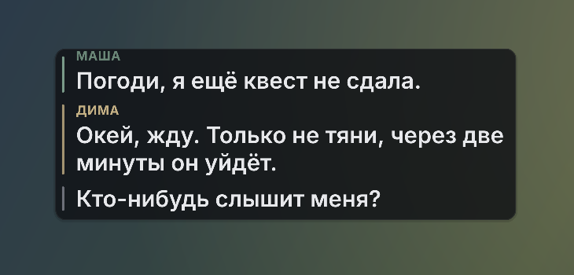
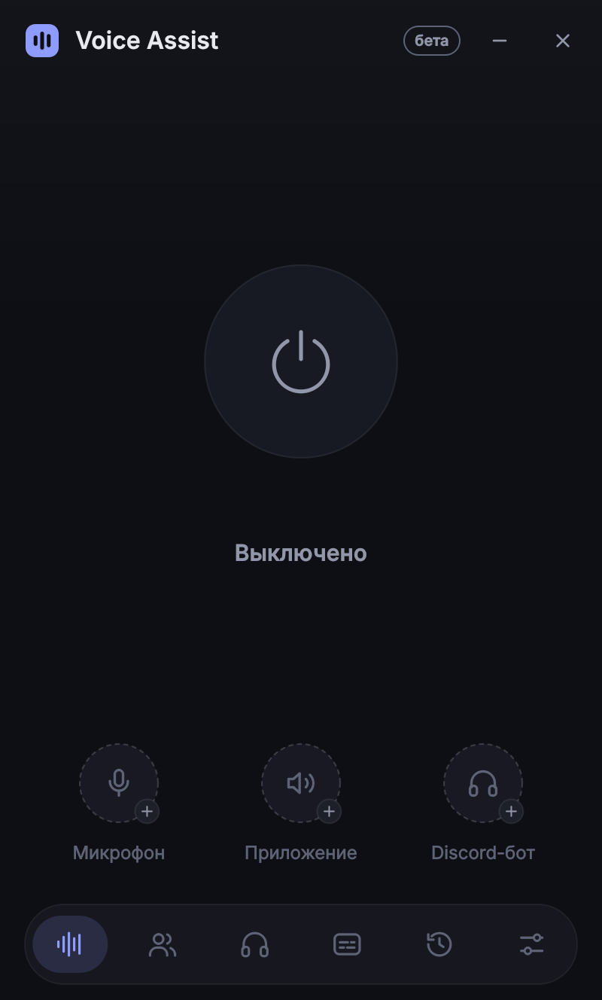

# Voice Assist

Субтитры для живой речи поверх любых окон: Discord, игры, созвоны, видео.
Для тех, кто плохо слышит или просто теряет нить разговора.

> **Бета, версия 1.0.** Основное работает, но возможны ошибки.
> Если что-то не так - [напишите](#если-что-то-сломалось).

## Что умеет

- Показывает субтитры с микрофона, из любого приложения (игра, браузер,
  плеер) или из голосового канала Discord.
- Подписывает, кто говорит. В Discord - точно, по нику, даже когда говорят
  одновременно. В остальных случаях узнаёт знакомые голоса по короткому
  образцу.
- Понимает русскую речь, а полная версия - ещё и английскую, с переводом
  на русский.
- Сохраняет расшифровки и умеет расшифровать готовую запись или видео.
- Работает на вашем компьютере: звук и текст никуда не отправляются.

## Что нужно

- Windows 11 (64-бит).
- Видеокарта не обязательна. Если процессор слабый и субтитры отстают,
  попробуйте включить «Видеокарта» на вкладке «Отклик». Нужна поддержка DirectML.

## Исходники

На странице [Releases](https://github.com/leksa-aleph/voice-assist-public/releases)
доступен архив исходников 1.0 beta. Шаги запуска и сборки на Windows,
включая подготовку моделей, описаны в [документации разработчика](docs/DEVELOPMENT.md).

## Как пользоваться

1. Нажмите большую кнопку - загрузятся модели распознавания.
2. Под кнопкой выберите, что слушать: микрофон, приложение или Discord-бот.
3. Нажмите кнопку ещё раз - пойдут субтитры.

Вкладки внизу окна:

- **Голоса** - запишите имя и 30 секунд речи человека, дальше программа
  сама подпишет его реплики.
- **Discord** - настройка бота, см. ниже.
- **Субтитры** - где они на экране, размер текста, сколько строк, фон.
- **История** - сохранённые расшифровки. Сюда же можно перетащить запись
  или видео, чтобы получить текст.
- **Отклик** - скорость против нагрузки, видеокарта, английский язык
  и перевод, журнал работы.

Поверх игры в полноэкранном режиме субтитры не видны - включите в игре
режим «оконный без рамки».

 

## Discord-бот

Через бота Discord присылает звук каждого участника отдельно, поэтому имя
в субтитрах всегда точное. Бот - ваш собственный: он заходит в голосовой
канал молча и с выключенным микрофоном, а звук распознаётся на вашем
компьютере.

Настраивается один раз на вкладке с наушниками:

1. **Создать бота** в [Discord Developer Portal](https://discord.com/developers/applications):
   New Application, любое имя, вкладка Bot - Reset Token - Copy.
2. **Вставить токен** в программу. Он хранится зашифрованным, прочитать его
   может только ваш пользователь Windows.
3. **Позвать бота на сервер.** Нужно право «Управлять сервером» - если его
   нет, попросите владельца сервера открыть ссылку.
4. **Зайти в голосовой канал** - бот придёт следом и будет ходить за вами
   по каналам.

Если бота создавал не тот, кому нужны субтитры, напишите в Discord `/join`
(или `/субтитры`) - бот запомнит вас. `/leave` - уйти.

Проверить одному: включите «Мой голос» на вкладке Discord и говорите -
по умолчанию бот ваш голос не берёт.

Важно:
- Бота видят все в канале. Предупредите участников, что разговор
  расшифровывается.
- Боты не заходят в личные и групповые звонки - только в голосовые каналы
  серверов.
- Если Discord у вас работает только через обход блокировок для отдельных
  программ, добавьте туда `node.exe` из папки программы
  (`discord_bridge`).

## Если что-то сломалось

Откройте [Issues](https://github.com/leksa-aleph/voice-assist-public/issues)
и укажите версию программы, шаги и результат. Вкладка «Отклик» показывает
версию и открывает журнал работы. Если в журнале есть сообщение об ошибке,
приложите только нужный фрагмент и уберите из него личные данные.
Журналы старых сборок могут содержать реплики из разговоров.

## Ограничения

- Субтитры показываются только на одном мониторе.
- Без бота похожие голоса могут путаться. Если программа не уверена,
  она пишет реплику без имени.
- Короткие служебные слова, игровые ники и редкие имена распознаются
  хуже остального.

## Где хранятся данные

Всё остаётся на компьютере:

- настройки, образцы голосов, токен бота, история - `%LOCALAPPDATA%\voice-transcriber`;
- журнал работы - `%APPDATA%\voice-transcriber\voice-transcriber.log`.

Расшифровки сохраняются по умолчанию. Чтобы прекратить сохранение новых
сеансов, выключите «Сохранять» на вкладке «История». Там же можно удалить
ранее сохранённые сеансы.

## Для разработчиков

Запуск из исходников, сборка, модели и тесты -
[docs/DEVELOPMENT.md](docs/DEVELOPMENT.md).

## Из чего собрано

- Поиск речи - [Silero VAD](https://github.com/snakers4/silero-vad) v6 (MIT)
- Русская речь - [GigaAM](https://github.com/salute-developers/GigaAM) v3
  от Salute Developers (MIT); ONNX-версия -
  [istupakov/gigaam-v3-onnx](https://huggingface.co/istupakov/gigaam-v3-onnx) (MIT),
  признаки по образцу [onnx-asr](https://github.com/istupakov/onnx-asr) (MIT)
- Узнавание голоса - WeSpeaker ResNet34, обучена на VoxCeleb (CC BY 4.0)
- Английская речь - Parakeet TDT 0.6B v3 от NVIDIA (CC BY 4.0), ONNX -
  istupakov/parakeet-tdt-0.6b-v3-onnx
- Перевод - Helsinki-NLP opus-mt-tc-big-en-zle (Apache-2.0)
- ONNX Runtime с DirectML, numpy, PyAV (FFmpeg), PyQt6, proc-tap
- Discord-бот - discord.js и @discordjs/voice, opusscript

## Лицензия

Исходный код Voice Assist доступен по [MIT](LICENSE). Условия и источники
компонентов установщика перечислены в [уведомлениях о лицензиях](docs/THIRD_PARTY_NOTICES.md).
